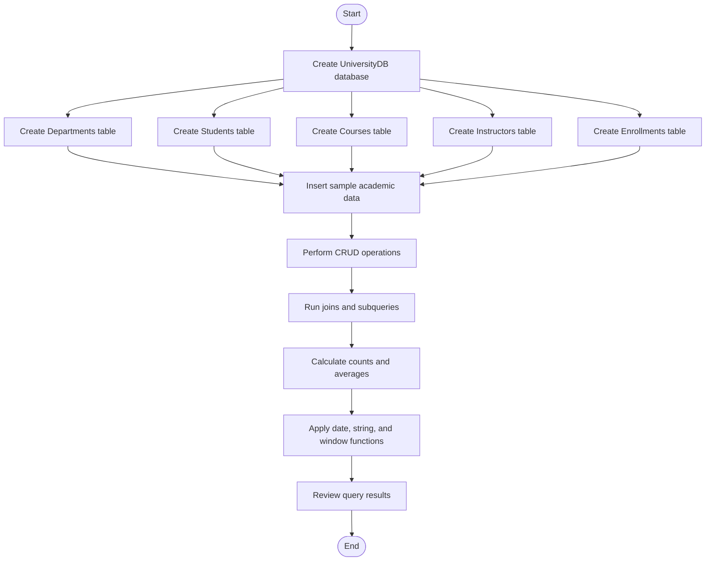

# 🎓 University Course Management System

> A MySQL database project for managing university departments, students, courses, instructors, and student enrollments.

## 📑 Table of Contents

- [🌟 About the Project](#-about-the-project)
- [🎯 Objectives](#-objectives)
- [🛠️ Technologies Used](#️-technologies-used)
- [🗃️ Database Design](#️-database-design)
- [🔗 Table Relationships](#-table-relationships)
- [🔄 Project Flowchart](#-project-flowchart)
- [💡 SQL Concepts Used](#-sql-concepts-used)
- [📸 Screenshots](#-screenshots)
- [▶️ How to Run](#️-how-to-run)
- [📊 Queries and Features](#-queries-and-features)
- [📁 Project Structure](#-project-structure)
- [🚀 Future Enhancements](#-future-enhancements)

## 🌟 About the Project

The **University Course Management System** is a database project developed using MySQL. It stores information about university departments, students, courses, instructors, and enrollments. The SQL script demonstrates database operations and queries used to retrieve and analyze academic data.

The project is suitable for practicing database management concepts, SQL joins, aggregate functions, subqueries, date functions, and window functions.

## 🎯 Objectives

- 🏫 Organize university departments and courses.
- 👩‍🎓 Store student details and enrollment dates.
- 👨‍🏫 Maintain instructor information and salaries.
- 📝 Record which students enroll in which courses.
- 🔎 Retrieve academic information using SQL queries.
- 📈 Summarize enrollments and analyze course data.

## 🛠️ Technologies Used

- **Database:** MySQL
- **Language:** SQL
- **Tools:** MySQL Command Line or MySQL Workbench
- **Main file:** `university_course_management_system.sql`

## 🗃️ Database Design

The database is named `UniversityDB` and contains five tables:

| Table | Purpose | Important columns |
|---|---|---|
| `Departments` | Stores department details | `DepartmentID`, `DepartmentName` |
| `Students` | Stores student information | `StudentID`, `FirstName`, `LastName`, `Email`, `BirthDate`, `EnrollmentDate` |
| `Courses` | Stores course details and credits | `CourseID`, `CourseName`, `DepartmentID`, `Credits` |
| `Instructors` | Stores instructor details and salary | `InstructorID`, `FirstName`, `LastName`, `Email`, `DepartmentID`, `Salary` |
| `Enrollments` | Links students with courses | `EnrollmentID`, `StudentID`, `CourseID`, `EnrollmentDate` |

## 🔗 Table Relationships

- A department can have multiple courses.
- A department can have multiple instructors.
- A student can have multiple enrollment records.
- A course can have multiple enrollment records.
- `Courses.DepartmentID` references `Departments.DepartmentID`.
- `Instructors.DepartmentID` references `Departments.DepartmentID`.
- `Enrollments.StudentID` references `Students.StudentID`.
- `Enrollments.CourseID` references `Courses.CourseID`.

## 🔄 Project Flowchart



## 💡 SQL Concepts Used

- 🏗️ Database and table creation: `CREATE DATABASE`, `CREATE TABLE`
- 🔑 Primary keys and foreign keys
- ➕ Insert records with `INSERT`
- 🔍 Retrieve records with `SELECT`
- ✏️ Modify records with `UPDATE`
- 🗑️ Remove records with `DELETE`
- 🔗 `INNER JOIN` and `LEFT JOIN`
- 📊 Aggregate functions: `COUNT()`, `AVG()`, `MAX()`
- 🧩 Subqueries and `IN`
- 🧮 `GROUP BY` and `HAVING`
- 📅 Date functions: `YEAR()` and `TIMESTAMPDIFF()`
- 🔤 String function: `CONCAT()`
- 📈 Window function: `SUM() OVER (...)`
- ⚖️ Conditional logic using `CASE`
- 🧹 `DISTINCT` and `LIMIT`

## 📸 Screenshots

The screenshots below show sample SQL output from the project. Keep the `screenshots` folder beside this README file so the images render correctly on GitHub.

### 🧾 Query results — Screenshot 1

.jpeg)

### 📊 Query results — Screenshot 2

.jpeg)

## ▶️ How to Run

1. Install and start MySQL Server.
2. Open MySQL Workbench or the MySQL Command Line.
3. Open or copy the contents of `university_course_management_system.sql`.
4. Connect to your MySQL server.
5. Execute the SQL script.
6. Review the result tables produced by the `SELECT` queries.

> ⚠️ **Important:** The first statement is `DROP DATABASE IF EXISTS UniversityDB;`. Running the script deletes the existing `UniversityDB` database before recreating it. Do not run it against a database containing data you need to keep.

## 📊 Queries and Features

The SQL script demonstrates queries to:

- Add, view, update, and delete sample records.
- Find students enrolled after 2022.
- Retrieve Mathematics courses.
- Count students enrolled in each course.
- Find students enrolled in both specified courses or either course.
- Calculate average course credits.
- Find the maximum instructor salary in Computer Science.
- Count students per department.
- Compare `INNER JOIN` and `LEFT JOIN` results.
- Use a subquery to find enrollments in courses with more than ten students.
- Extract the enrollment year.
- Combine instructor first and last names.
- Calculate a running total of enrollment counts.
- Label students as `Senior` or `Junior` based on enrollment date.

**Note:** The sample dataset is small, so queries requiring more than five or ten students may return no rows. This is expected for the included sample data.

## 📁 Project Structure

```text
UniversityCourseManagementSystem/
├── university_course_management_system.sql
├── README.md
└── screenshots/
    ├── SQL(i).jpeg
    └── SQL(ii).jpeg
```

## 🚀 Future Enhancements

- Add more sample students, courses, departments, and enrollments.
- Add constraints such as `UNIQUE` for student and instructor email addresses.
- Create views for common academic reports.
- Add reports for course capacity and enrollment trends.
- Connect the database to a Python or web-based user interface.

---

⭐ **Thanks for checking out this University Course Management System project!**
